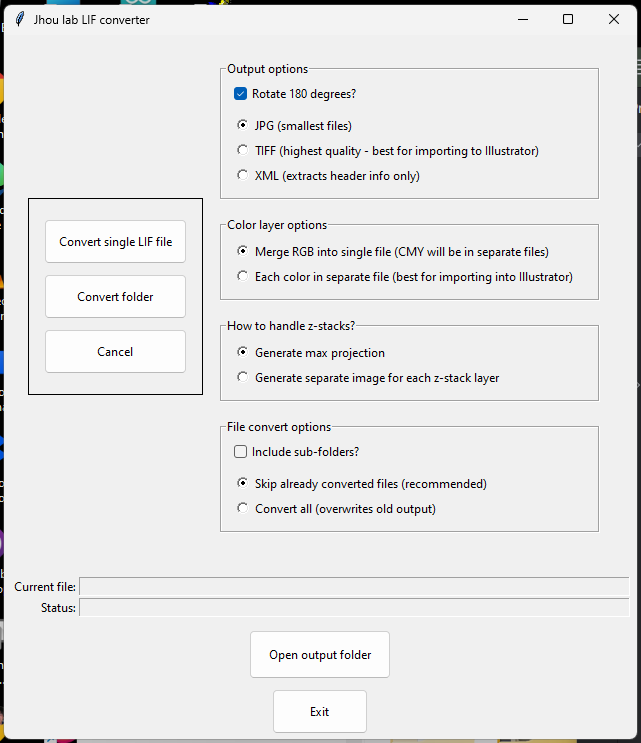

## Overview

This folder contains three tools for analyzing brain section data. They can be run by double
clicking Windows .bat files that start with the word RUN_, e.g.:

    RUN_ASSEMBLER.bat
    RUN_LIFCONVERTER.bat
    RUN_TIFS_TO_JP2.bat

When you first run any of these, it will auto-create a local Python environment in a `.venv` folder (in the folder above this
one, shared with the ABC and CCF browsers) and auto-install the libraries it needs; for the assembler this took about 30
seconds. These three tools need about 400MB of free space; the ABC browser's much larger libraries bring the shared `.venv`
to about 1.1GB. It only does this once, and all tools use the same `.venv`, for efficiency.

The section assembler is also available as a standalone Windows program, with Python and everything else inside it, so that you
need neither these .bat files nor Python: download [SectionAssembler-windows.zip](https://github.com/tomjhou/Brain-anatomy-tools/releases/latest/download/SectionAssembler-windows.zip) (always the newest version),
unzip it, and run `SectionAssembler\SectionAssembler.exe`. The LIF converter and the TIFF converter are not packaged yet.

## 1. Section assembler

MBF's NeuroInfo program has a serial section assembler to turn raw images into an aligned .jpx stack.
However, it can't revise an alignment once it's made. This program opens raw images, or existing NeuroInfo
image stacks or reconstructions, and lets you move, rotate and flip individual sections against their
neighbors, then exports a new JPX. At any time you can save, reload, or re-edit your work.

## Running it ...

Double-click `RUN_ASSEMBLER.bat` for the start window. The workflow proceeds in 5 steps:

1. **Load images** (`section_loader.py`): choose Zeiss `.czi` slide scans, .jpx image stacks from NeuroInfo,
   .xml reconstruction files from NeuroInfo, or individual JP2 image files. Once you've selected the images,
   you will be prompted to save a project file (its name ends in `_project.json`) that stores the image files, their order, and later
   their alignment. You can reload this file later to resume work where you left off. The project file and images
   must be in the same folder. If you open a NeuroInfo .jpx file, it will attempt to find the corresponding
   reconstruction .xml file and .h5 case file that NeuroInfo also saves alongside the image stack. You can also
   load the .xml and it will try to find the .jpx and .h5. Once the project is fully loaded (step 4), this app's
   own project file will supersede the NeuroInfo .xml and .h5 files, and those will no longer be needed.
2. **Detect sections**: There are options to either automatically or manually detect brain sections (against
   background) using thresholding and size heuristics.
3. **Order sections**: You can drag sections into any order, or insert placeholders if sections are missing or damaged.
4. **Edit outlines and alignment**: You can refine the section outline, or adjust its position (moves, rotations, flips, outline changes, order).
5. **Export .jpx**: When you are satisfied with the alignment, you can export a new .jpx image stack that
   NeuroInfo can read. For a large project (>200 images) this might take almost an hour, even on a fast machine,
   so it is best to wait until you are truly satisfied with the outlines and alignment.

All edits are saved into the project file, so you can always close and reopen the app and continue where you
left off, or edit previous edits.

## More details on exporting (step 5)

- Sections are re-rendered from the original images (the .czi scans or JP2 files), so repeated edits don't add
  resampling or compression losses; unchanged sections are copied byte for byte (unless you choose "Re-render
  unchanged sections too when exporting (slower)" in File > Options).
- Exported files remember their edits, so they can be reopened in the aligner and adjusted again.
- Brightness controls are display-only; exported pixel values come from the original images.

`neuroinfo_stack.py` is the library behind it; `python neuroinfo_stack.py info <stack.jpx>` lists a
stack's sections and their alignment.

## 2. LifConverterGUI

This program converts Leica .LIF files to .TIF

### Notes about one of the dependencies of this program ...

LifClass.py (used by LifConverterGUI.py) relies on "reader.py", which contains a bug-fixed version of Nick Negretti's "readlif" project.
Here are the changes I've made from the pypi.org version 0.6.5:

1. No longer crashes when reading newer lif files where the end of the file is zero instead of having one final magic number
2. No longer crashes if number of offsets is less than number of detected images (usually indicates truncated or corrupted file)
3. Fixed bug where magic number value error would close file and cause the wrong kind of error to be reported (truncation)

The python lif viewer is based on this java version:
https://github.com/ome/bioformats/blob/master/components/formats-gpl/src/loci/formats/in/LIFReader.java

## 3. TIFF TO JP2 converter

This program converts Leica TIFF exports to JPEG2000 files for NeuroInfo (double click `RUN_TIFS_TO_JP2.bat`).

`tifs_to_jp2.py` merges per-channel greyscale TIFFs exported from Leica (`<section>--C00.tif` ... `--C03.tif`)
into one multi-channel JPEG2000 per section, with the same header layout NeuroInfo/Microfile+ writes
(channel colors, layer names and pixel size in an MBF XMP block). 12-bit data is scaled x16 automatically.

## 4. Other tools

`tools/jp2_boxdump.py <file.jp2>` prints a JPEG2000 file's header boxes and codestream settings, for
comparing converted files with NeuroInfo's own.

